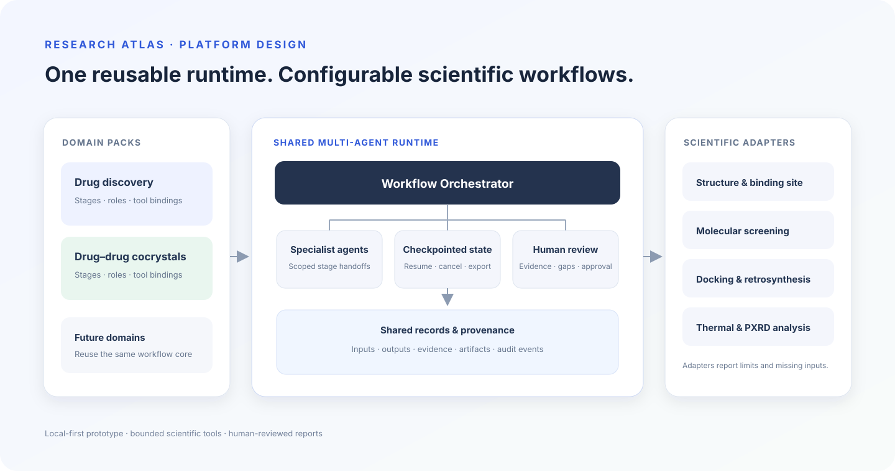
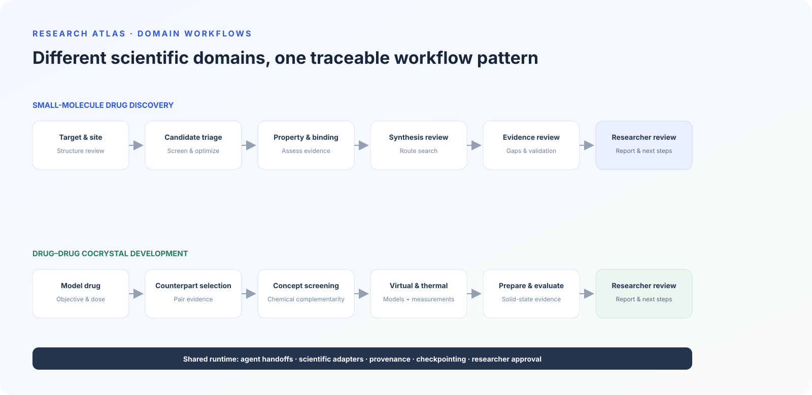
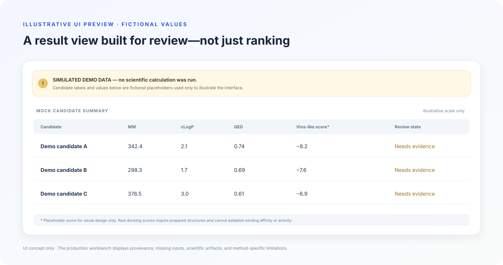

# Research Atlas

**Portfolio:** [Project overview](https://tepeng0213.github.io/research-atlas/) · **Source:** [GitHub repository](https://github.com/Tepeng0213/research-atlas)

**A multi-agent scientific workbench for small-molecule discovery and drug–drug cocrystal research.** Research Atlas combines reusable workflow orchestration with domain-specific scientific adapters, evidence tracking, and researcher review.

> Research software prototype. A completed workflow is not evidence of drug efficacy, clinical synergy, synthetic feasibility, or cocrystal formation. Results must be interpreted within each method's stated limits and validated experimentally.

## Portfolio summary

Research Atlas is a local-first, full-stack research prototype built with Python, SQLite, and a buildless JavaScript interface. It supports workspace-based accounts and two configurable research workflows. Scientific calculations run in bounded subprocesses and return structured results, provenance, artifacts, and explicit missing-input/model states.

**Implemented highlights**

- Shared workflow engine with domain manifests, role handoffs, checkpoints, cancellation, researcher approval, and report export.
- Email/password accounts, email verification and recovery, workspace roles, invitation codes, CSRF checks, and audit events.
- Ten registered scientific adapters covering molecular structure, screening, docking, retrosynthesis, cocrystal pairing, thermal analysis, preparation planning, and PXRD processing.
- Isolated scientific workers with a 240-second stage timeout; model and email credentials are not passed to those workers.
- Explicit distinction between computed results, partial results, missing scientific inputs, missing dependencies, and failures.

## Project design

The same orchestration runtime can host multiple scientific domains. Domain packs define the stages and specialist roles; adapters provide calculations; the runtime records evidence, open requirements, and researcher review.



The first two domain packs use this shared pattern:



## Illustrative results preview

**This is a UI mockup. Candidate labels and values are fictional placeholders; no scientific calculation produced them.** The application displays real adapter outputs only when the required inputs and dependencies are available, with method limits and evidence gaps alongside the result.



## Local development

The basic application runs on Python 3.9 or later. The scientific environment is pinned for Python 3.11. On macOS, `start.command` uses `.venv` when present and falls back to the system Python for the basic app.

```sh
uv venv --python 3.11 .venv
uv pip install --python .venv/bin/python -r requirements-science.lock
python3 scripts/fetch_science_assets.py
.venv/bin/python -m workbench
```

Open <http://127.0.0.1:8765>. Stop the server with Ctrl+C. Use `--port 8766` if the default port is busy. The scientific asset download includes a historical ZINC stock file; it is not a live inventory feed.

If you only want to run the basic web app without the scientific environment:

```sh
python3 -m workbench
```

Scientific stages then report missing dependencies instead of fabricating results. The default data directory is `data/`. It contains the SQLite database, uploaded files, result artifacts, and downloaded scientific assets. It is ignored by Git and should be backed up separately. Do not run multiple instances against the same SQLite data directory.

## Scientific adapters and current limits

All ten scientific tool contracts are registered. “Connected” means an adapter can execute; it does not mean that every model, data source, or experimental input needed for a particular task is installed.

| Workflow stage | Implemented calculation | Important open requirements |
|---|---|---|
| Structure and binding site | BioPython parses PDB/mmCIF and reports chains, backbone gaps, alternate conformations, and a supplied or residue-derived site center. | Receptor preparation, missing-atom repair, protonation, cofactors, and expert review of the biological conformation. |
| Candidate discovery and optimization | RDKit standardization, deduplication, descriptors, QED, similarity, optional aromatic C–H-to-F enumeration, and opt-in ChEMBL lookup. | A complete licensed compound library, validated target-specific activity data, and a validated generative model. Enumerated analogs are not predicted to be more active. |
| Binding and property assessment | RDKit descriptors; when a prepared PDBQT receptor and binding box are supplied, Meeko prepares ligands and AutoDock Vina performs docking. | Target-specific docking benchmarks and validated ADMET/selectivity models. Vina scores are not measured affinity or binding free energy. |
| Retrosynthesis | AiZynthFinder runs neural-network-guided route search with the published USPTO model, templates, filter, and historical ZINC stock. | Reaction conditions, yields, stereoselectivity, live supplier availability, and chemist review. A stock match does not guarantee a purchasable reagent. |
| Counterpart drug selection | RDKit structure/descriptors and dose-to-crystal stoichiometry comparisons. | Verifiable combination-therapy evidence, pharmacokinetic compatibility, and clinical interaction assessment. |
| Conceptual cocrystal screening | Hydrogen-bond donor/acceptor complementarity and empirical ΔpKa checks when pKa values are supplied. | Reliable pKa values matched to solvent and temperature, three-dimensional synthons, competing phases, and experiments. |
| Virtual cocrystal screening | Paired Morgan features and conversion of supplied quantum-chemical interaction energies. An administrator may configure a hash-checked ONNX model. | No validated and appropriately licensed cocrystal-formation model is bundled. No formation probability is inferred from simple features. |
| Thermal screening | DSC/TGA CSV peak and mass-change processing; an ideal binary eutectic baseline when melting points and fusion enthalpies are supplied. | Measured instrument curves, calibration and baseline decisions, and experimental phase diagrams. The ideal baseline does not predict formation of a new cocrystal phase. |
| Preparation planning | Stoichiometric mass-fraction calculations and a control-focused experimental design outline. | Validated solvents, quantities, temperatures, times, and a reproducible crystallization SOP. The adapter does not generate an unvalidated executable procedure. |
| Solid-state evaluation | PXRD peak extraction and non-negative reference-pattern mixture fitting when reference patterns are provided. | Calibrated instrument data, reference phases, independent structure determination, and additional characterization. A fit does not identify a new cocrystal by itself. |

Scientific JSON examples demonstrate input format only; they are not recommendations or experimental evidence. Public database lookups are disabled by default. PDF files are accepted for storage but are not parsed. Each scientific output records method metadata, evidence, and downloadable artifacts where available.

### Scientific assets and licensing

The optional assets downloaded by `scripts/fetch_science_assets.py` are stored under `data/models/retrosynthesis/`. Their sources, checksums, and upstream license notes are recorded in `sources.json`. The historical stock file does not establish current supplier inventory or commercial availability. DeepCocrystal is not bundled because its upstream license is non-commercial. Review all upstream model, dataset, and software terms before commercial use.

## Accounts and workspaces

The first account created in an empty local database becomes its owner and receives the initial workspace. Later accounts receive separate workspaces or can join through single-use invitation codes. Roles are admin, researcher, reviewer, and viewer. Workspace members share projects within that workspace; project-level private membership is not implemented.

The local version supports email/password authentication, SMTP verification and password recovery, hashed session tokens, CSRF checks, login rate limits, and audit events. SMTP configuration is optional. Copy `mail.local.env.example` to `mail.local.env` and fill it locally. Never commit real SMTP passwords, API keys, databases, uploads, model weights, or result artifacts. Email links must use the actual HTTPS URL when deployed; `127.0.0.1` links only work on the computer running the app.

The project has not undergone a production security review. It does not yet include MFA, project-level permissions, account-approval controls, or a production deployment profile.

## Optional language-model advice

The orchestration can run without an LLM. To enable chat-completions-compatible advice, set the following environment variables before starting the server:

```sh
export LLM_BASE_URL="http://127.0.0.1:8000/v1"
export LLM_MODEL="your-model"
export LLM_API_KEY="your-key"
.venv/bin/python -m workbench
```

LLM output is advisory and is not treated as a calculation or scientific evidence. Enabling a remote provider sends the run objective, constraints, previous agent advice, scientific-result summaries, and attachment metadata. The current request limit caps the number of attempts, not spend; timed-out calls may still incur charges.

## Architecture

```text
web/                           Buildless browser interface
domain_packs/*/manifest.json   Workflow stages, roles, and instructions
workbench/server.py            HTTP API, authentication, uploads, downloads
workbench/store.py             SQLite state, projects, files, events, audit
workbench/engine.py            Checkpointed agent handoffs and review flow
workbench/tools.py             Scientific registry and optional LLM client
workbench/science/             Bounded scientific adapters and runner
scripts/                       Reproducible public scientific asset download
tests/                         Workflow, account, mail, and science checks
data/                          Local runtime data; never commit
```

The workflow state machine is `draft → queued → running → awaiting_review → queued → completed`, with `cancelled` and `failed` terminal states. “Completed” means the workflow stages finished. It does not imply scientific or experimental success. Current execution uses one local worker and SQLite; it is not horizontally scalable.

## Sharing and deployment

**GitHub should host the source code, not the running backend or user data.** GitHub Pages can host a static portfolio page, project overview, screenshots, and demo video. It cannot run this Python API, SQLite database, background worker, or scientific subprocesses.

For a public portfolio, a sensible progression is:

1. Publish a cleaned public GitHub repository with this README, architecture and workflow diagrams, optional sanitized screenshots or a short demo video, and a clear limitations section.
2. Host a static portfolio/case-study page on GitHub Pages or another static host. Link to the source repository and demo video.
3. If an interactive demo is important, deploy one protected instance to a container host with HTTPS, persistent storage, environment-managed secrets, and backups. Use synthetic/public sample inputs only. Keep the service at one instance until SQLite and the single-worker design are replaced.

The current code binds to loopback and restricts Host/Origin to localhost. Do not expose this development server through a tunnel. A public deployment needs an explicit host/origin configuration, a production entrypoint, HTTPS-only cookies, registration controls, persistent-volume configuration, backup and restore procedures, health checks, and a security review. The scientific stack and retrosynthesis assets are also much heavier than a static portfolio site.

For a later multi-user product, replace local SQLite/files with managed PostgreSQL and object storage, move computation to a separately managed queue/worker, add per-project authorization and spend controls, then scale the web and scientific workers independently. Do not scale the current SQLite-backed service horizontally.

## Verification

Run the local suite with:

```sh
.venv/bin/python -m unittest discover -s tests -v
```

The scientific tests exercise real RDKit descriptors, PDB parsing, AutoDock Vina docking, AiZynthFinder route search, and DSC/TGA/PXRD processing. They do not validate drug activity or cocrystal formation.

## Resume bullet (draft)

> Built Research Atlas, a local-first multi-agent scientific workbench with configurable drug-discovery and cocrystal workflows; integrated RDKit, AutoDock Vina, AiZynthFinder, and solid-state data analysis behind bounded adapters with provenance, artifact tracking, and researcher review.
