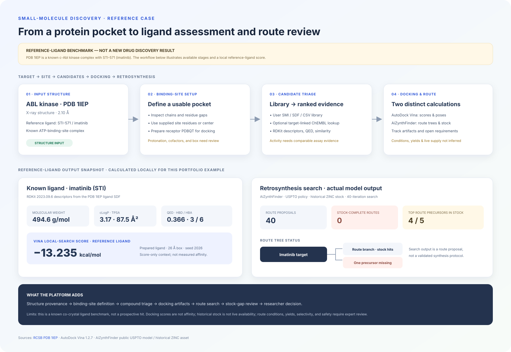
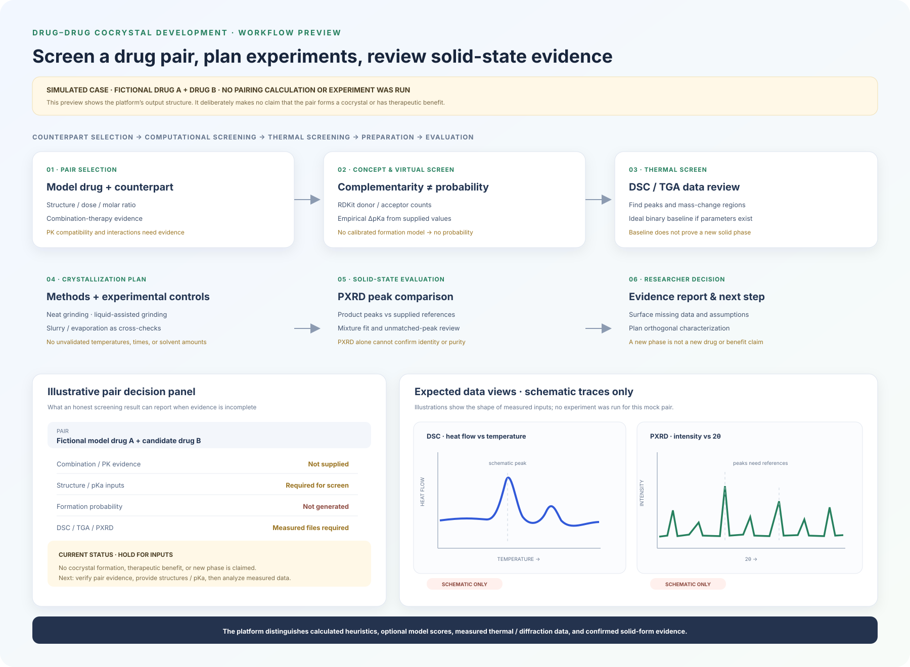

# Research Atlas case studies

These examples show the two scientific workflows the workbench is designed to support. The small-molecule panel uses a reproducible reference-ligand calculation and a real retrosynthesis search. It is a benchmark walkthrough, not a prospective hit. The cocrystal panel is a UI mockup with schematic plots; it contains no measured or calculated pair result.

## 1. Binding site → ligand assessment → retrosynthesis review

### Reference input

[PDB 1IEP](https://www.rcsb.org/structure/1IEP) is an X-ray structure of the c-Abl kinase domain in complex with STI-571 (imatinib), reported at 2.10 Å resolution. The repository contains the corresponding public AutoDock Vina tutorial receptor and ligand fixtures; their origin is documented in [`tests/fixtures/vina/SOURCE.md`](../tests/fixtures/vina/SOURCE.md).

### Calculated ligand descriptors and reference-pose score

RDKit 2023.09.6 calculated the following descriptors from the supplied STI ligand structure: molecular weight **494.6 g/mol**, cLogP **3.17**, TPSA **87.5 Ų**, QED **0.366**, HBD **3**, and HBA **6**. AutoDock Vina 1.2.7 returned a **−13.235 kcal/mol** local-search score for the Meeko 0.7.1-prepared reference ligand using a 26 Å cube centered at **(16.0041, 52.5419, 16.2205) Å** (seed 2026, CPU 1).

This score begins from a known crystallographic ligand pose and is not a prospective docking result, measured binding affinity, or evidence that a new compound will bind. It does not test independent pose recovery.

### Retrosynthesis search output

AiZynthFinder 4.3.2 searched the supplied STI structure with the published USPTO expansion policy, a 40-iteration limit, up to four transformations, and the downloaded historical ZINC stock file. The search produced **40 route proposals**, **0 stock-complete routes**, and a top route with **4 of 5 precursor molecules** found in that historical stock. One modeled precursor was absent. This accurately demonstrates how the workbench should expose a route blocker rather than label the target synthesis-ready.

AiZynthFinder proposes reaction trees; it does not establish reaction conditions, yields, stereoselectivity, current supplier stock, safety, or laboratory feasibility. Chemist review and literature-backed route development are still required. The stock snapshot is historical and should not be used as a live purchasing claim.

### How this maps to the product workflow

The intended small-molecule workflow accepts a protein structure or PDB ID, a binding-site definition, and a supplied compound library or optional target-linked ChEMBL query. It parses structure provenance and site geometry, standardizes candidates, calculates molecular properties, performs Vina docking only with a prepared receptor and search box, and passes candidate SMILES to retrosynthesis search. The report keeps docking, assay evidence, synthesis suggestions, and missing inputs distinct.

## 2. Drug pair → cocrystal screening → preparation and characterization

This image is an explicitly simulated interface for a **fictional drug pair**. It shows the result fields and evidence gates the workflow should present; no pair screening, thermal measurement, or diffraction analysis was run for it.

The current adapters support:

1. **Counterpart selection:** structure and descriptor comparison plus dose-to-crystal molar-ratio calculations when dose data are supplied. Combination-therapy evidence, pharmacokinetics, interactions, and clinical benefit remain separate evidence requirements.
2. **Conceptual screening:** hydrogen-bond donor/acceptor complementarity and empirical ΔpKa tendencies from user-supplied pKa values. These checks do not establish a three-dimensional synthon or formation probability.
3. **Virtual screening:** paired molecular features and conversion of supplied quantum-chemical interaction energies. There is no validated, licensed formation model bundled, so the system does not invent a probability.
4. **Thermal screening:** DSC/TGA CSV peak and mass-change processing, plus an ideal binary eutectic baseline when melting points and fusion enthalpies are provided. The baseline does not predict a new cocrystal phase.
5. **Preparation planning:** stoichiometric mass fractions and a control-focused outline for grinding, liquid-assisted grinding, slurry, or evaporation comparisons. The adapter does not invent executable conditions or claim a validated SOP.
6. **Evaluation:** PXRD peak extraction and non-negative fitting against supplied references. Unmatched peaks and fit residuals are review signals, not phase identification; composition, DSC, and independent structural characterization are needed.

## Sources and interpretation

- [RCSB PDB entry 1IEP](https://www.rcsb.org/structure/1IEP) — c-Abl kinase in complex with STI-571.
- [AutoDock Vina](https://github.com/ccsb-scripps/AutoDock-Vina) — docking and local-search engine.
- [AiZynthFinder](https://github.com/MolecularAI/aizynthfinder) — neural-network-guided retrosynthesis search.
- [Fixture provenance](../tests/fixtures/vina/SOURCE.md) — source files and license notes for the reference structure and ligand.

All computed outputs are method-specific. They do not establish drug efficacy, clinical synergy, synthetic feasibility, or formation of a new solid phase.
